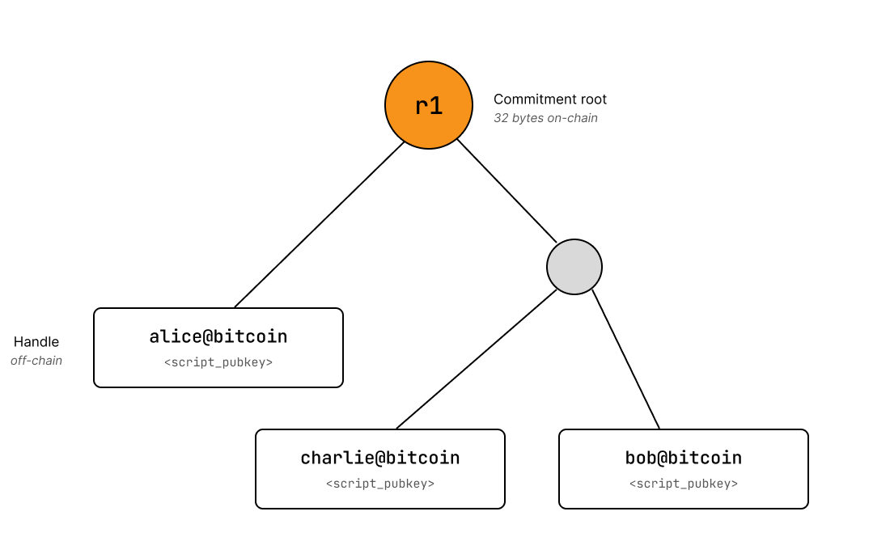
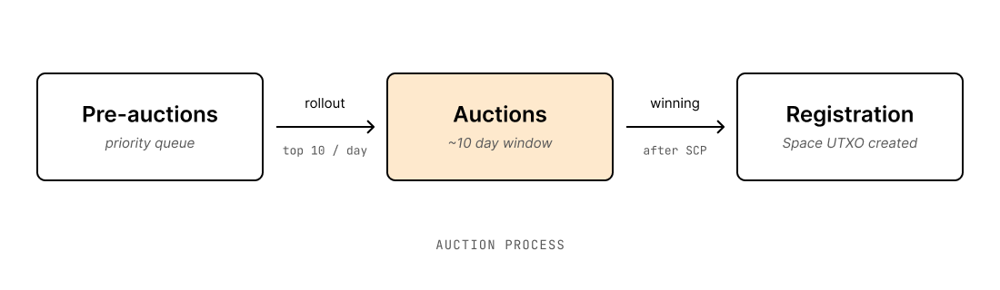
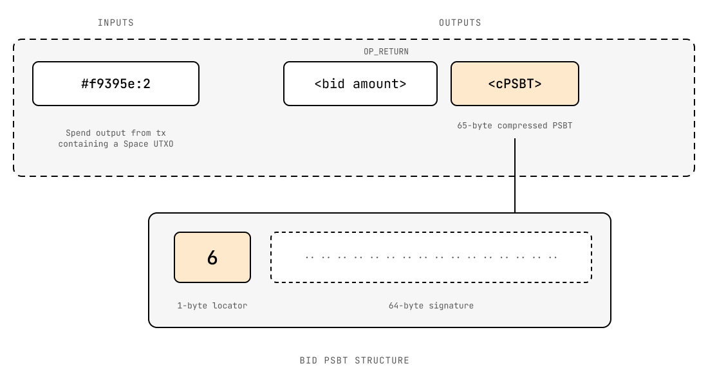

+++
title = "Bitcoin Layer 2 for Naming: Spaces Protocol"
date = 2026-09-10
description = "Spaces is an off-chain name issuance protocol enabling a self-sovereign alternative to DNS that is anchored to Bitcoin."

[extra]
unlisted = true
+++

Spaces is an off-chain name issuance protocol anchored to Bitcoin, designed as a self-sovereign alternative to DNS.

> **TODO:** why this is better than DNS/BIP-353, NIP-05, … etc? why do we need self-soverign naming for bitcoin at all??

Handles look like email addresses: `yourname@example`. The top level part, `@example`, is acquired through an on-chain auction mechanism built from Bitcoin scripts, and the proceeds of those auctions are burned. There is no token, no foundation, and no centralized holder of top level spaces.

Why have a top level at all? Without one, every handle would sit in a single flat namespace, and every name would have to be settled on-chain or issued by a single centralized operator that gatekeeps the namespace. Because anyone can win a top level at auction, no single party controls the namespace as a whole. The hierarchy splits the work, so that only top levels are settled on Bitcoin, and each one becomes a namespace whose holder can issue handles off-chain, cheaply and under whatever rules they choose. Operators hold no power over the names they issue. Once a name is added to the tree, the operator cannot revoke or modify it.

The sections below walk through the individual components of the Spaces stack.

## The Handles Tree

Winning a top level space makes the bidder its operator. The auction mechanism itself is covered further down. An operator's job is issuing handles, and that happens entirely off-chain.

A handle is a binding between a human-readable name and a script pubkey, which is a standard Bitcoin locking script. The operator maintains a Binary Merkle Trie containing every one of these bindings for their space, and periodically commits the root of that tree to Bitcoin as a single 32-byte hash.

That 32 bytes covers the whole tree regardless of size. Ten handles or ten million handles produce the same on-chain footprint. Because names are never individually written to the chain, issuing one costs the operator nothing beyond the periodic commitment they were making anyway.

Commitments are strictly append-only. Each new commitment extends the previous state with additions, and existing bindings are never modified or removed. Certificates prove that any additions in a commitment did not exist in any prior commitment. That constraint is what prevents double issuance. An operator cannot issue `alice@bitcoin` twice, because the second issuance would require proving that `alice` was absent from a tree in which it already appears.

The client-side validator accepts commitments into the chain of roots without inspecting their internal structure. The off-chain certificate includes all information needed to attest its validity.

### Certificates

What a handle owner actually holds is an off-chain certificate, and it contains two proofs. The first is an inclusion proof showing that the handle exists in a committed tree. The second is a non-existence proof showing that the handle was not present in any earlier commitment. Together they establish that the name belongs to its holder and never belonged to anyone else. Once issued, the certificate is valid indefinitely. There is no renewal, no expiry, and no on-chain transaction required to keep it.

Proving absence explicitly against every prior commitment is correct, and it requires no cryptography beyond hashing, since a handle owner simply carries the full set of exclusion proofs. However, that proof grows with each commitment the operator makes, and becomes verbose over time. The alternative is recursive zk-SNARKs or STARKs, which compress the full chain of non-existence checks into a single succinct proof validating the rolling hash across all commitments. The protocol itself does not require ZK, but resolvers and light verifiers can implement it.

### What the Operator Can and Cannot Do

The operator decides who receives a handle, which is genuine gatekeeping at the point of issuance. The auction removes any single party's control over the namespace as a whole, but it does not remove an operator's discretion within their own space.

The operator cannot revoke a handle, redirect it, or recover it. The certificate is self-contained and verifies independently of whoever issued it. An operator who goes offline, sells the space, or disappears entirely has no effect on existing holders, whose certificates continue to work.

There is one thing an operator can break, and it is their own namespace. Submitting an invalid commitment irreversibly ends the space's ability to issue new handles, because every subsequent commitment would need to prove non-existence against a broken predecessor and cannot do so.

The same asymmetry holds if a space expires and is reacquired by someone else. A new operator needs the complete handle tree to prove non-existence for anything new, and if that tree is unavailable, the space permanently loses the ability to issue. Every handle already issued continues to function.

The worst realistic failure is therefore that nobody can issue new names in that space, rather than that an existing name was taken. Concentrating the risk there is a considerably better outcome.

## Auctions for Top Level Spaces

> **TODO:** explain how the auctions process work based on the figure above, ten per day why rate limited like this … etc. ensure reader understands this relates to top level spaces only.

The auction mechanism is built entirely from existing Bitcoin scripting, with no soft forks or changes needed to Bitcoin.

A single UTXO is designated to represent the space opened for auction, and this Space UTXO is passed from bidder to bidder for the duration of the auction. A bid consists of two things. The bidder burns the bid amount in an `OP_RETURN` output, and leaves behind a partially signed transaction. That transaction states, in effect, that if the bidder is outbid, the next bidder may consume the Space UTXO as long as they refund the amount.

Suppose Bob opens with 1 BTC. Alice wants the name and bids 1.5 BTC. She completes Bob's PSBT, which returns his 1 BTC, and burns an additional 0.5 BTC, bringing the total burned for the auction to 1.5 BTC. She then publishes her own UTXO and PSBT as the new leading bid, and the pattern repeats until someone closes the auction.

`OP_RETURN` outputs are small, and the same output is already being used to burn the bid, so the PSBT has to fit alongside it. The protocol compresses the whole PSBT into 65 bytes, consisting of a 1-byte locator plus a 64-byte signature.

Simultaneous bids resolve themselves without any protocol logic. Two bidders racing on the same Space UTXO produce two transactions spending the same output; one confirms and the other is rejected by full nodes as a double spend. Only one bid succeeds in burning coins.

Rules that Bitcoin cannot enforce are enforced by incentive instead. Spending the auctioned UTXO outside the bid pattern is technically possible, but it gains the offending bidder nothing: the coins they burned are already gone.

## Constructing Transactions for Transfers and Key Rotations

Most handles have no on-chain presence at all, and the majority of handle owners would never need a transaction. However, some operations are inherently interactive, such as rotating to a new key or swapping a handle atomically for payment, and those require on-chain state.

This is done through UTXO binding. Because every handle is already bound to a unique script pubkey in the tree, binding it on-chain requires nothing more than a transaction that spends to that script pubkey. There is no metadata, no `OP_RETURN`, and no encoding of the name anywhere. The UTXO itself is the binding, identified purely by the script it pays to. Multiple handles can be bound in the same transaction to share the cost.

Once bound, the script pubkey in the certificate becomes the handle's genesis, and ownership follows the UTXO on-chain from there. The original certificate is still needed: it is the genesis proof that links the name to whichever UTXO currently represents it. Bound UTXOs do not need to stay in Bitcoin's UTXO set forever. They can hold any value and be spent as money, and can be rebound if interactive functionality is needed again.

## A Self-Sovereign Name System Must Verify on Mobile

Most decentralized name systems require a full node to verify anything. That is workable for servers but not for phones, which is where names are actually resolved, and it is a large part of why DNS continues to win.

Spaces follows a similar model to [Utreexo](https://bitcoinops.org/en/topics/utreexo/), which replaces the UTXO set with a hash accumulator so that a node can validate spends without storing the set itself. Spaces applies the same idea to naming: the entire protocol state compresses into a single 32-byte hash, the trust anchor. Once a client has that hash, verification is stateless, and a certificate either checks out against the anchor or it does not.

The question is where the phone obtains the trust anchor. If it fetched the anchor from a server, that server would become the trust root again. Today the answer is [Veritas](https://spacesprotocol.org/docs/use/veritas/), a small desktop application that syncs from a checkpoint, verifies Bitcoin's header chain, scans the handful of transactions that Spaces cares about, and computes the anchor locally. The user then scans the anchor into a mobile client, where it remains usable for up to two weeks, provided a state summary that stale is acceptable.

The resulting value is one the user computed rather than a signature accepted from a third party, but it still means running software on a laptop. The next step, planned for early 2027, is a zero-knowledge certificate on the order of 250 KB. It proves the same computation (header chain, relevant transactions, protocol rules) as one succinct STARK, so that a client downloads it once and verifies it in milliseconds with nothing to sync.

[BIP-353](https://github.com/bitcoin/bips/blob/master/bip-0353.mediawiki) reaches a similar place by a different route, but its root of trust is the [DNSSEC key hierarchy](https://www.cloudflare.com/learning/dns/dnssec/root-signing-ceremony/), which requires accepting keys on the basis of who holds them. The Spaces trust anchor is instead a hash that the verifier derives independently.

## Resolution and Record Storage

Spaces deliberately stores no records on-chain. The responsibility of the protocol ends at proving who owns what.

Records such as payment addresses, Nostr pubkeys, and websites travel through Certrelay, an HTTP-based relay network. Clients resolve proofs and records from Certrelay nodes and verify them against the Bitcoin-anchored trust anchor. Publishing and updating records touch zero on-chain bytes.

Nostr is the clearest example of why this matters. A Nostr identity is a raw pubkey, and NIP-05 makes it human-readable by pointing at a DNS domain, which places a registrar and the DNS root back underneath an identity that was otherwise self-sovereign. A Spaces handle does the same job without that dependency. It is human-readable, it resolves to a key, and the client verifies it against a hash it computed itself.

## How Is This a Bitcoin Layer 2?

The label "Layer 2" gets stretched to cover sidechains, federations, and bridged tokens that do not inherit the security of Bitcoin in any meaningful sense.

Spaces is a client-side validation protocol. The validity of a name is established by proofs its holder carries and any client can check. No committee signs off on state, no federation holds a multisig, and there is no bridge or separate consensus to attack. Bitcoin supplies the one thing the protocol actually needs from it, which is an ordering of commitment roots that nobody can rewrite.

There is also no security budget to maintain. Nothing is bonded or slashed, no funds sit locked to keep participants honest, and no economic assumption has to keep holding for a name to remain with its owner. Coins are burned in the auctions, but the burn only allocates top levels, deciding who receives `@example`, and no part of state validity rests on it. There is no new token anywhere in the design. Bids are denominated in Bitcoin, transfers settle on Bitcoin, and a handle can be swapped atomically for Bitcoin in a single transaction.

Spaces does depend in part on off-chain availability: operators have to publish commitments for new issuance to continue, and relays have to serve records for lookups to resolve. Both degrade toward the inability to obtain a new name or to fetch a record, never toward a name changing hands without the consent of its owner. The security of what a holder already owns reduces to Bitcoin and a hash function.

## Wrapping Up

> **TODO:** wrap up how spaces fits into the Bitcoin ecosystem, the low on-chain footprint, issuance is decentralized across many operators, adoption is needed to make it more useful … etc

* * *

_The white paper is at_ [_spacesprotocol.org/paper_](https://spacesprotocol.org/paper)_; the protocol, wallet, Certrelay and explorer are at_ [_github.com/spacesprotocol_](https://github.com/spacesprotocol)_._